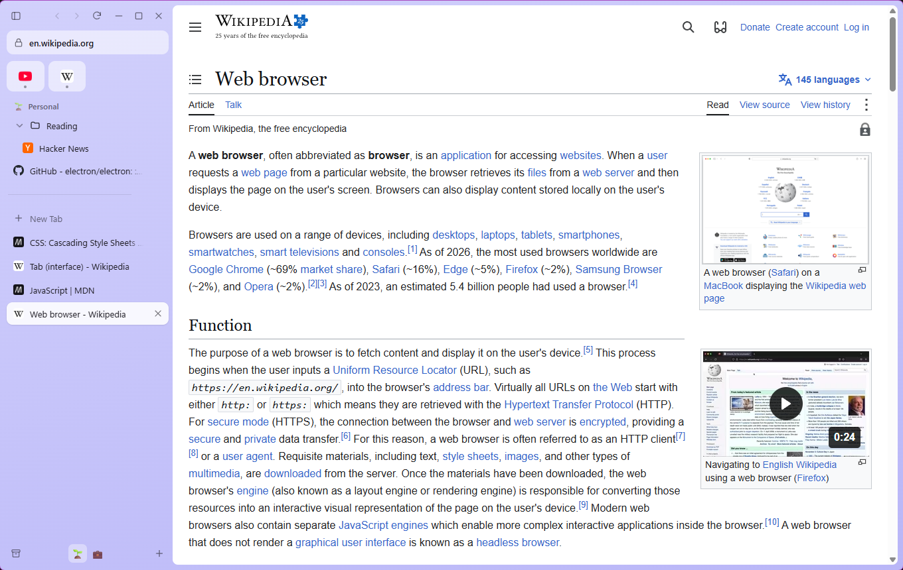
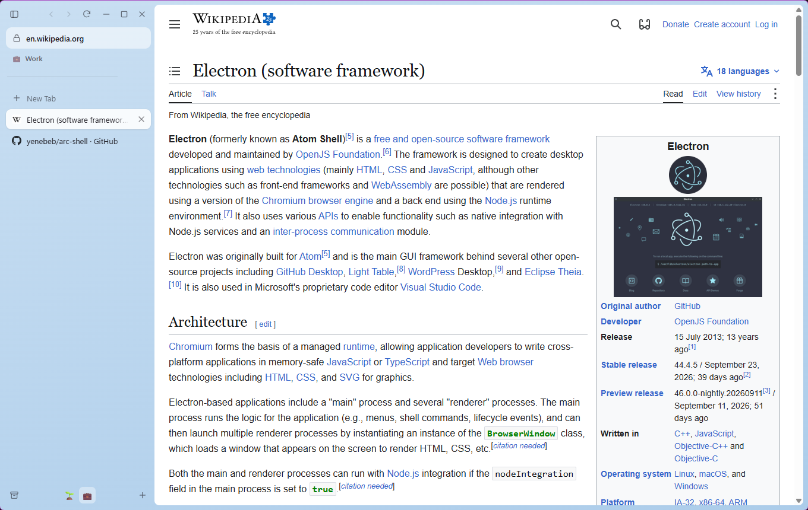
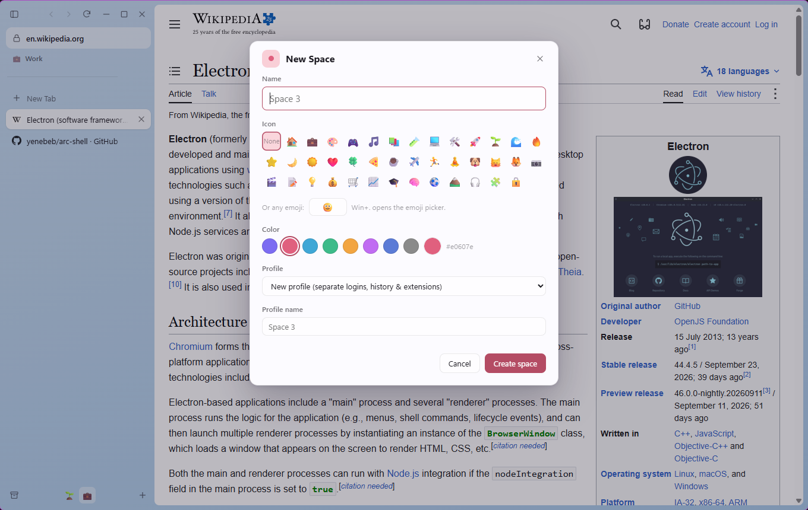
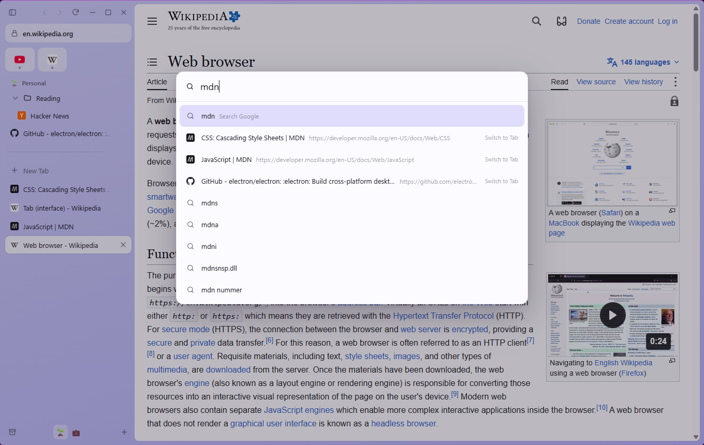
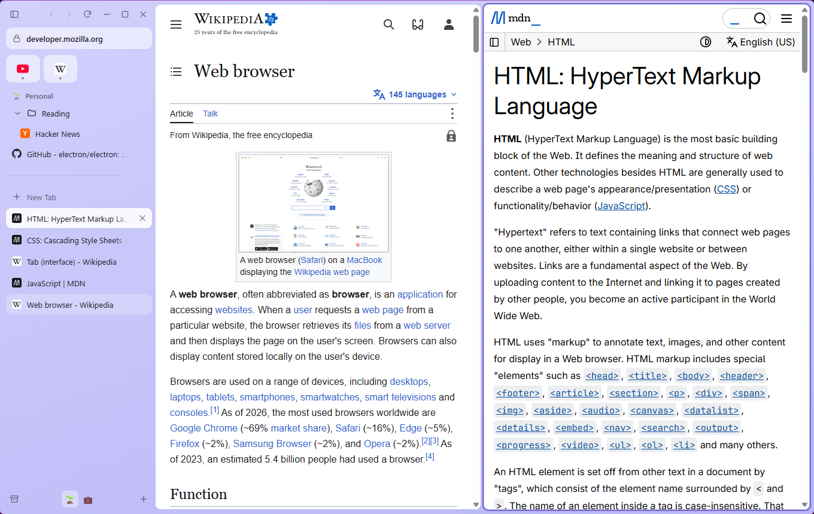
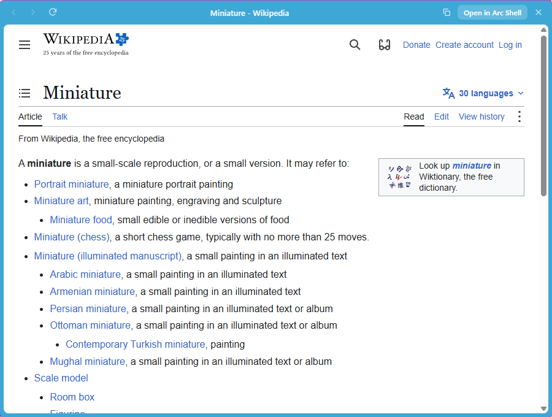

# Arc Shell

**An open-source browser that works the way Arc did.** It has a vertical sidebar, Spaces with their own profiles, a command bar, split view and Little Arc. It runs on Windows and macOS.

The Browser Company is shutting Arc down on **22 December 2026**. After that date the app stops working and Arc accounts are deactivated. Arc Shell is meant for people who don't want to switch to Dia or go back to a tab strip. It reproduces Arc's workflow and imports your Arc sidebar, so you can carry on as before.

> Arc Shell is an independent project. It is not affiliated with, endorsed by or connected to The Browser Company. "Arc" is their trademark; this project re-implements the interaction design on top of Chromium (via Electron).



## Contents

- [Features](#features)
- [Install](#install)
- [Moving from Arc](#moving-from-arc)
- [Keyboard shortcuts](#keyboard-shortcuts)
- [FAQ](#faq)
- [Where your data lives](#where-your-data-lives)
- [Building from source](#building-from-source)
- [How it works](#how-it-works)
- [Roadmap and known limitations](#roadmap-and-known-limitations)
- [Contributing](#contributing)
- [License](#license)

## Features

### The sidebar

Everything sits in one vertical sidebar, with the page taking up the rest of the window. From top to bottom:

- **Window controls and navigation:** toggle the sidebar, back, forward and reload. On Windows the minimize, maximize and close buttons are here too; on macOS the traffic lights are.
- **URL pill:** shows the current site. Click it, or press `Ctrl/⌘+L`, to edit the URL. Buttons for installed extensions appear on the right of the pill.
- **Favorites:** a grid of icons for the sites you always have open (mail, calendar, chat). A dot shows which ones are loaded.
- **Pinned tabs and folders:** tabs that stay until you remove them. Folders can be nested and collapsed.
- **Today:** everyday tabs below the divider, newest first. "Clear" archives them all at once.
- **Bottom bar:** the Library (archive, history, downloads), your Spaces, and **+** to create a new space.

Hide the sidebar with `Ctrl/⌘+S` for a full-width page. Move the mouse to the left edge of the window and it slides back over the page until you move away.

Everything in the sidebar supports drag and drop. You can drag tabs between Favorites, Pinned, folders and Today, drop a folder inside another folder, or drop a tab on a Space icon to move it there. Right-click any item for its options, such as rename, duplicate, open in split view, mute or move to a Space. Middle-click closes a tab, and double-click renames it.

### Spaces, each with its own profile



A Space is a separate sidebar with its own name, emoji and color. The whole window takes on that color.

- **Every new Space gets its own profile by default.** A profile has its own cookies and logins, site storage, cache, history and Chrome extensions. So you can be signed in to your work Google account in the *Work* space and your personal one in *Personal* at the same time.
- **Spaces can also share a profile**, the same way Arc linked Spaces to profiles. Pick "Share with …" when creating a space.
- **Favorites belong to the profile.** Every space that uses the profile shows the same favorites.
- **Pinned tabs, folders and Today tabs belong to the space.**

Switch spaces by swiping two fingers sideways on the sidebar, by clicking the icons at the bottom, or with `Ctrl+1–9` (macOS) / `Alt+1–9` (Windows) and `⌘⌥←/→` / `Ctrl+Alt+←/→`.



### Pinned tabs that act like Arc's

- A pinned tab remembers its **pinned URL**. When you browse away, a `/` appears in front of its title. Hover over its icon and click the arrow to go back to the pinned URL.
- **Closing a pinned tab** (`Ctrl/⌘+W`) only unloads it to free memory. It stays in the sidebar, and clicking it opens the pinned URL again.
- `Ctrl/⌘+D` pins or unpins the current tab.

### Today tabs archive themselves

Unpinned tabs you haven't looked at for **12 hours** move to the Archive automatically. You can change this to 24 hours, 7 days or 30 days, or turn it off. Tabs that are playing audio, or are part of a split view, are never archived. Closed tabs go to the Archive too. Find them again in the Library, search for them in the command bar, or use `Ctrl/⌘+Shift+T`.

### Command bar



`Ctrl/⌘+T` opens the command bar, which replaces the new-tab page. Type to:

- **switch to an open tab** in any space ("Switch to Tab" is the top result when the name matches);
- open a URL, or search with your search engine, with live suggestions;
- find pages from your **history** and **archive**;
- run **commands** such as *Toggle Sidebar*, *Copy URL*, *New Space*, *Import from Arc* or *Make Arc Shell the Default Browser*;
- jump to a space by typing its name.

`Shift+Enter` opens the result in split view. `Ctrl/⌘+L` opens the command bar with the current URL, ready to edit.

### Split view



Show up to four tabs side by side. There are several ways to start one:

- press `Ctrl+Shift+=` and pick a tab or URL;
- Shift-click a tab in the sidebar;
- choose "Open Link in Split View" from a link's context menu.

Drag the gap between panes to resize them, and double-click it to make them equal again. The focused pane has a colored outline. `Ctrl+Shift+-` closes the split.

### Little Arc



A small, minimal window for quick lookups. Open one with `Ctrl+Alt+N` / `⌘⌥N`. When Arc Shell is your default browser, links from other apps (Slack, Discord, email) open here too, so your sidebar stays tidy. If you want to keep the page, click **Open in Arc Shell**: it moves into your Today tabs as it is, without reloading. If you don't, just close the window.

### Built-in ad and tracker blocking

Ads and trackers are blocked out of the box, in every profile, using the same kind of filter lists as uBlock Origin and EasyList (via [Ghostery's open-source engine](https://github.com/ghostery/adblocker)). That includes network blocking, cosmetic filtering that hides empty ad slots, and the scriptlets used against YouTube-style ads. The shield in the URL pill shows how many requests were blocked on the current page. Click it to allow ads on that site, for example if the site breaks, and click again to block them again. The lists update daily. You can turn blocking off completely in Settings.

### Chrome extensions

Install extensions straight from the **Chrome Web Store** by visiting it and clicking *Add to Chrome*, or run the *Get Extensions* command. Extensions are installed **per profile**, so your work space can have different extensions from your personal one. They're kept up to date automatically, and their buttons appear in the URL pill.

### Importing

- **From Arc:** Spaces (with their emoji and colors), profiles, Favorites, pinned tabs, folders, Today tabs, the archive and browsing history. See [Moving from Arc](#moving-from-arc).
- **From Chrome, Edge or Brave:** browsing history and bookmarks. Bookmarks arrive as a pinned folder.

The source browser's files are never changed: Arc Shell copies them first and reads the copy.

### The rest

- **Find in page** (`Ctrl/⌘+F`) shows a match counter.
- **`Ctrl+Tab` switcher** in most-recently-used order. Keep holding Ctrl and press Tab again to go further back.
- **Library** (`Ctrl/⌘+Shift+L`) with tabs for the Archive, History (searchable, grouped by day), Downloads and Spaces.
- **Downloads** save to your Downloads folder automatically, with progress shown in the sidebar.
- **Zoom** per tab, **mute** from the sidebar, **copy URL** (also as Markdown), **duplicate tab**.
- **Open in Chrome** (`Ctrl/⌘+Alt+O`) for the rare site that only works in Google Chrome.
- Permission prompts for the camera, microphone, location and notifications, asked once per site.
- Light, dark or system theme, and a choice of Google, DuckDuckGo, Bing, Kagi or Brave Search.

## Install

Download the latest version from the **[Releases page](https://github.com/yenebeb/arc-shell/releases)**.

### Windows 10 / 11

1. Download `Arc-Shell-Setup-<version>-x64.exe`, or the `-arm64.exe` for Windows on ARM devices such as the Surface Pro X or Snapdragon laptops.
2. Run it. It installs for your user only, needs **no admin rights**, and opens Arc Shell when it finishes.
3. The app isn't code-signed yet, so Windows SmartScreen may say *"Windows protected your PC"*. Click **More info → Run anyway**.

**Make it your default browser:** open the command bar and run *Make Arc Shell the Default Browser*, or go to Windows **Settings → Apps → Default apps → Arc Shell → Set default**.

**Uninstall:** Settings → Apps → Installed apps → Arc Shell → Uninstall. Your profiles stay in `%APPDATA%\Arc Shell` in case you reinstall; delete that folder to remove them.

### macOS 13 or newer

1. Download the `.dmg` for your Mac: **`-arm64.dmg`** for Apple Silicon (M1–M5), **`-x64.dmg`** for Intel.
2. Open it and drag **Arc Shell** to **Applications**.
3. The app isn't notarized by Apple yet, so the first launch is blocked. Open it once, click **Done**, then go to **System Settings → Privacy & Security**, scroll down and click **Open Anyway**. (On macOS 15 and later, Control-click → Open no longer skips this.)
   Or, in Terminal: `xattr -dr com.apple.quarantine "/Applications/Arc Shell.app"`
4. To make it your default browser: run *Make Arc Shell the Default Browser* from the command bar, or go to **System Settings → Desktop & Dock → Default web browser**.

### Linux (experimental)

There's an `.AppImage` for x64 on the Releases page. Make it executable (`chmod +x`) and run it. On Ubuntu 24.04+ you may need to allow unprivileged user namespaces for Chromium's sandbox.

## Moving from Arc

> **Do this before 22 December 2026.** After that date Arc no longer opens, but its files stay on disk, so the import keeps working on a copy of the folder.

### On the same computer

1. Install Arc Shell.
2. Press `Ctrl/⌘+T`, type **Import from Arc** and press Enter. You'll also find it under Settings → Import.
3. Arc Shell finds Arc automatically and asks for confirmation. Your spaces, favorites, pinned tabs, folders and history appear in the sidebar.

### From a Mac to a Windows PC (or another computer)

1. On the Mac, copy the folder `~/Library/Application Support/Arc` to a USB stick or cloud drive. In Finder, press `⇧⌘G` and paste that path to get there.
2. On the other computer, run **Import from Arc**, choose **Use a Different Copy…** and select the copied `Arc` folder or the `StorableSidebar.json` file inside it.

### What isn't imported

- **Saved passwords, cookies and logins.** Browsers encrypt these with a key tied to the machine, so you'll need to sign in to your sites again. Before Arc goes away, export your passwords from Arc (`arc://settings/passwords` → ⋮ → Export) and import them into a password manager such as Bitwarden or 1Password. Their extensions work in Arc Shell.
- **Boosts, Easels and Notes.** Arc Shell doesn't have these features yet.
- **Extensions.** Reinstall them from the Chrome Web Store, in each space that needs them.

## Keyboard shortcuts

These are Arc's shortcuts. **Mod** means `⌘` on macOS and `Ctrl` on Windows. The same list is in Settings → Keyboard Shortcuts.

| Action | macOS | Windows |
| --- | --- | --- |
| New tab (command bar) | `⌘T` | `Ctrl+T` |
| Edit URL | `⌘L` | `Ctrl+L` / `Alt+D` |
| Toggle sidebar | `⌘S` | `Ctrl+S` |
| Copy URL | `⌘⇧C` | `Ctrl+Shift+C` |
| Copy URL as Markdown | `⌘⇧⌥C` | `Ctrl+Shift+Alt+C` |
| New Little Arc window | `⌘⌥N` | `Ctrl+Alt+N` |
| Close tab (unload if pinned) | `⌘W` | `Ctrl+W` / `Ctrl+F4` |
| Reopen closed tab | `⌘⇧T` | `Ctrl+Shift+T` |
| Pin / unpin tab | `⌘D` | `Ctrl+D` |
| Clear unpinned (Today) tabs | `⌘⇧K` | `Ctrl+Shift+K` |
| Next / previous tab | `⌘⌥↓` / `⌘⌥↑` | `Ctrl+Alt+↓` / `Ctrl+Alt+↑` |
| Recent-tab switcher | `⌃Tab` / `⌃⇧Tab` | `Ctrl+Tab` / `Ctrl+Shift+Tab` |
| Next / previous space | `⌘⌥→` / `⌘⌥←` | `Ctrl+Alt+→` / `Ctrl+Alt+←` |
| Switch to space 1–9 | `⌃1–9` | `Alt+1–9` |
| Go to sidebar item 1–8 (9 = last) | `⌘1–9` | `Ctrl+1–9` |
| Add split view | `⌃⇧=` | `Ctrl+Shift+=` |
| Close split view | `⌃⇧-` | `Ctrl+Shift+-` |
| Find in page / next / previous | `⌘F` / `⌘G` / `⌘⇧G` | `Ctrl+F` / `F3` / `Shift+F3` |
| History | `⌘Y` | `Ctrl+Y` |
| Downloads | `⌘⌥L` | `Ctrl+J` |
| Library | `⌘⇧L` | `Ctrl+Shift+L` |
| Developer tools | `⌘⌥I` / `F12` | `Ctrl+Shift+I` / `F12` |
| Reload / hard reload | `⌘R` / `⌘⇧R` | `Ctrl+R` or `F5` / `Ctrl+Shift+R` or `Ctrl+F5` |
| Zoom in / out / reset | `⌘=` / `⌘-` / `⌘0` | `Ctrl+=` / `Ctrl+-` / `Ctrl+0` |
| Back / forward | `⌘[` / `⌘]` | `Alt+←` / `Alt+→` |
| Settings | `⌘,` | `Ctrl+,` |
| New folder | `⌘⌥⇧N` | `Ctrl+Alt+Shift+N` |
| Duplicate tab | `⌘⇧D` | `Ctrl+Shift+D` |
| Open in Chrome | `⌘⌥O` | `Ctrl+Alt+O` |

In a Little Arc window: `Mod+O` moves the page into the main window, `Mod+W` closes the window, and `Mod+Shift+C` copies the URL.

## FAQ

**Can I sign in to Google, Gmail, YouTube or Google Workspace?**
Yes. Signing in to Google websites works normally, including company SSO through Google, Microsoft Entra ID, Okta and similar. If your company only allows *managed* Google Chrome (device-trust or "compliant device" policies), that check can't be passed by any other browser. Use **Open in Chrome** for those sites.

**Can it sync my bookmarks and history through my Google account, like Chrome?**
No. Since 2021 Google has only allowed Google Chrome to use Chrome Sync, so no other browser can, whether Chromium-based or not. Use **Import from Chrome** to bring your history and bookmarks over once.

**Does it sync between my computers?**
Not yet. Each install keeps its own data. Syncing is on the [roadmap](#roadmap-and-known-limitations).

**Why Electron?**
Electron is real Chromium, so sites behave as they do in Chrome, and Chrome extensions work. It also let a small project build a fully custom interface without maintaining a fork of Chromium. The trade-off is memory use roughly on par with Chrome. Arc itself was Chromium too.

**Is it private?**
Arc Shell has no account and no telemetry, and sends no data anywhere. Its own network requests are search suggestions (sent to the search engine you chose), Chrome Web Store update checks for installed extensions, and a daily download of the ad-blocking filter lists from GitHub.

**Do I need an ad-blocker extension?**
No. Blocking is built in (see [Built-in ad and tracker blocking](#built-in-ad-and-tracker-blocking)). Ad-blocker *extensions* built on Manifest V3's `declarativeNetRequest`, such as uBlock Origin Lite, install but can't block, because Electron doesn't support that API.

## Where your data lives

| | Windows | macOS |
| --- | --- | --- |
| App data | `%APPDATA%\Arc Shell` | `~/Library/Application Support/Arc Shell` |
| Sidebar, spaces, settings | `state.json` | `state.json` |
| Per-profile history | `Profiles/<id>/history.sqlite` | same |
| Per-profile extensions | `Profiles/<id>/Extensions` | same |
| Ad-blocking filter cache | `adblock/engine.bin` | same |
| Cookies, site storage, cache | `Partitions/profile-<id>` | same |

## Building from source

You need **Node.js 22.12+** (24 recommended) and Git.

```bash
git clone https://github.com/yenebeb/arc-shell.git
cd arc-shell
npm install          # also downloads the Electron binary
npm run dev          # start with hot reload
```

| Command | What it does |
| --- | --- |
| `npm run dev` | Run the app in development mode, with a separate `Arc Shell (dev)` profile |
| `npm run build` | Production build into `out/` |
| `npm start` | Run the production build |
| `npm run typecheck` | TypeScript check |
| `npm test` | Unit tests: URL handling, shortcuts, sidebar model, Arc parser |
| `npm run test:e2e` | Build, then drive the real app with Playwright (tabs, spaces, splits, Little Arc, persistence) |
| `npm run dist:win` | Windows installers in `release/` |
| `npm run dist:mac` | macOS DMGs in `release/` (run on a Mac) |
| `npm run dist:dir` | Unpacked app for quick local testing |

### Releasing

1. Bump the version: `npm version patch` (or `minor` / `major`).
2. `git push --follow-tags`
3. GitHub Actions builds Windows, macOS and Linux and attaches them to a **draft release**. Review it on GitHub and click **Publish release**.

## How it works

```
┌───────────────────────── BrowserWindow ─────────────────────────┐
│ UI renderer (React): sidebar, window frame, split handles        │  ← bottom layer
│        ┌──────────────────── WebContentsView ───────────────────┐│
│        │ the web page (one view per open tab, per profile)       ││  ← middle
│        └────────────────────────────────────────────────────────┘│
│ Overlay view (transparent): command bar, find, panels, peek      │  ← top, only when open
└──────────────────────────────────────────────────────────────────┘
```

- The **main process** owns all state (`src/main/browser.ts`). The UI renderers get a full snapshot whenever something changes, and send back typed actions (`src/shared/actions.ts`).
- Every **profile** is an Electron session partition (`persist:profile-<id>`). Each one has its own extension host (`electron-chrome-extensions`, `electron-chrome-web-store`) and its own SQLite history (`node:sqlite`, so there are no native modules).
- Every **sidebar item** can have a live `WebContentsView`. Pages load lazily and unload when closed or archived, which keeps memory down.
- **Shortcuts** are caught in `before-input-event` on every web contents and matched on physical key codes, so they work regardless of keyboard layout or which page has focus.

| Path | Contents |
| --- | --- |
| `src/main/browser.ts` | Controller: spaces, tabs, splits, archive, shortcuts, actions |
| `src/main/window.ts` | Window layout and the overlay |
| `src/main/tab.ts` | A live page attached to a sidebar item |
| `src/main/profiles.ts` | Sessions, permissions, downloads |
| `src/main/extensions.ts` | Chrome extension APIs and the Web Store, per profile |
| `src/main/adblock.ts` | Built-in ad and tracker blocking for every profile |
| `src/main/little.ts` | Little Arc windows |
| `src/main/importers/` | Arc and Chromium importers |
| `src/shared/` | State types, actions, keymap, URL helpers (unit tested) |
| `src/renderer/` | React UI: `index` (sidebar), `overlay` (command bar and panels), `little` |
| `docs/` | Research notes: Arc's behavior and shortcuts, Arc's data format, Electron notes |

## Roadmap and known limitations

Already done: everything in [Features](#features).

Planned or open for contributions:

- [ ] Peek (a preview window for links from pinned tabs)
- [ ] Boosts (custom CSS/JS per site)
- [ ] Multiple main windows
- [ ] Sync between your own devices
- [ ] Notes / Easels
- [ ] Code signing and notarization, to remove the install warnings
- [ ] Auto-update

## Contributing

Issues and pull requests are welcome. If you're an Arc user and something doesn't behave the way Arc did, please open an issue describing what Arc did. [docs/arc-reference.md](docs/arc-reference.md) collects what we know about Arc's behavior, and is worth correcting too.

Before opening a PR, run `npm run typecheck && npm test && npm run test:e2e`.

## License

[GPL-3.0-or-later](LICENSE). Arc Shell is an independent project and is not affiliated with The Browser Company. "Arc" is a trademark of its respective owner.
